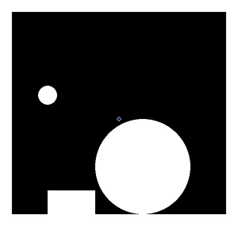
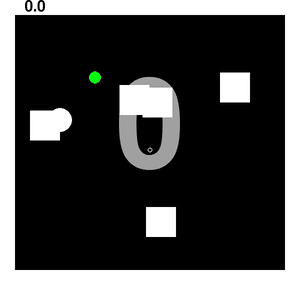

# Physics Engine

A 2D physics engine written from scratch in Python, with a small basketball game built on top of it. A small project I made in high school, coded by hand before AI.

<p align="center">
  
  &nbsp;&nbsp;
  
  <br>
  <em>Left: the example scene. Right: the basketball game. The dot is the mouse (red when clicking).</em>
</p>

## How it works

Everything is in [`Physics_Engine.pyw`](Physics_Engine.pyw). Lengths are in meters and masses in kg (the window is 5 m wide).

**Motion.** Each frame, we sum the forces $F$ applied to a moving object, then use Newton's second law and integrate over the frame time $\Delta t$:

```math
a = \frac{F}{m}, \qquad v \leftarrow v + a \Delta t, \qquad x \leftarrow x + v \Delta t
```

**Collision detection.** A ball collides with a round wall when the distance between the centers is smaller than the sum of the radii. For a rectangle, we take the point of the rectangle closest to the ball's center (by clamping the center's coordinates to the rectangle) and check if it is closer than the radius. In both cases we get the normal $n$ at the contact point.

**Collision response.** We first push the ball back out of the wall along $n$. Then the ball bounces: its velocity is reflected about the normal and loses some energy (restitution of 0.7):

```math
v \leftarrow 0.7 \left( v - 2 (v \cdot n) n \right)
```

Finally, if the sum of the forces points into the wall, we add the normal reaction $-(F \cdot n) n$, so a ball resting on the floor does not sink and a ball pushed against a wall slides along it.

## Usage

Needs Python and `pygame`.

```bash
python Physics_Engine.pyw   # example scene
python Basketball.pyw       # the game
```

A scene is a few lines at the end of the file. Forces go in the scene's `run` function, which is called at each frame.

```python
a = Scene()
ball = a.addMovingObj(Ball(0.2, 10, pos=Vect2(1, 3)))   # radius, mass
ball.velocity = Vect2(3, 0)
a.addStaticObj(Wall(Vect2(5, 0.5), Vect2(0, 0.5)))      # size, position
a.addStaticObj(RoundWall(1, Vect2(3, 1.5)))             # radius, position
a.run()
```

In both scenes, holding the mouse pushes the ball away from the cursor. In the basketball game, touch the green target as many times as possible in 60 seconds; the obstacles move after each point.

The same code works for side view scenes (with gravity) and top view scenes (like minigolf, with friction instead of gravity). For the moment it only handles moving/static collisions, not moving/moving ones.
